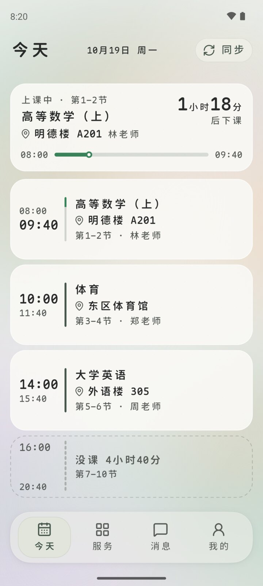
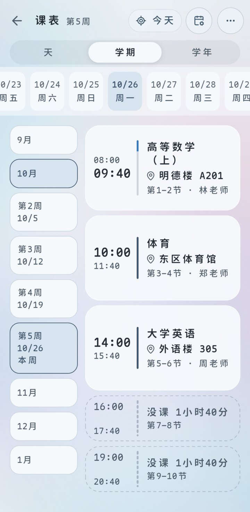
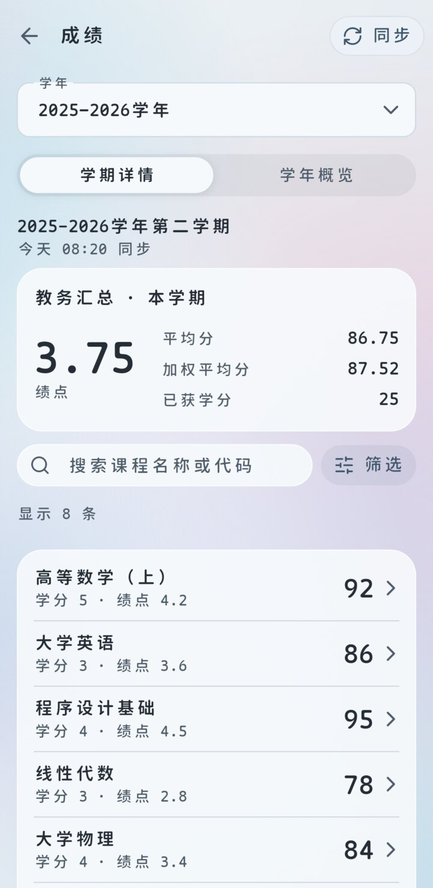
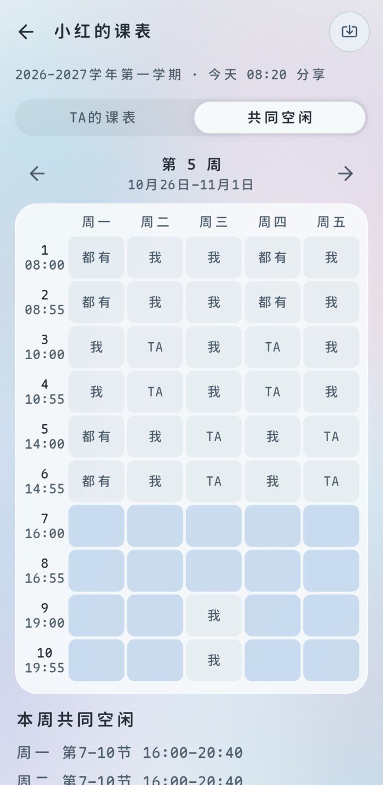
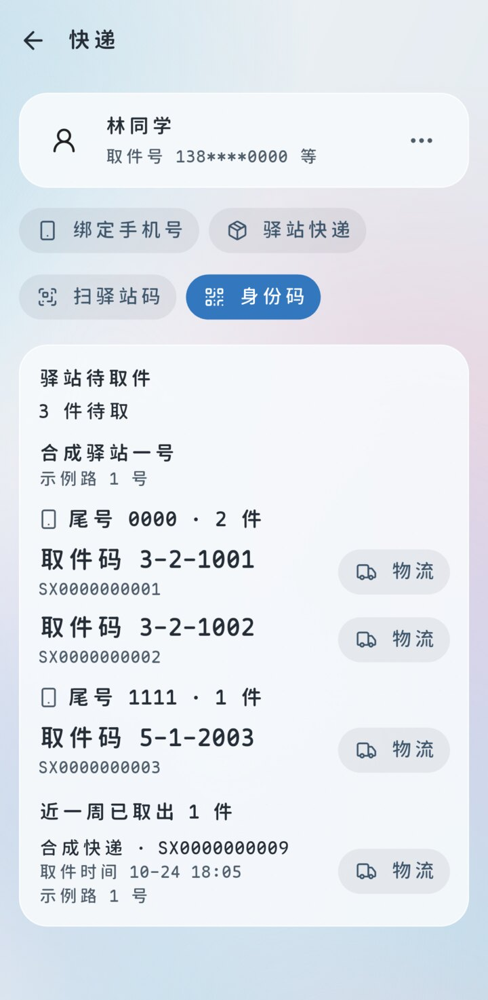
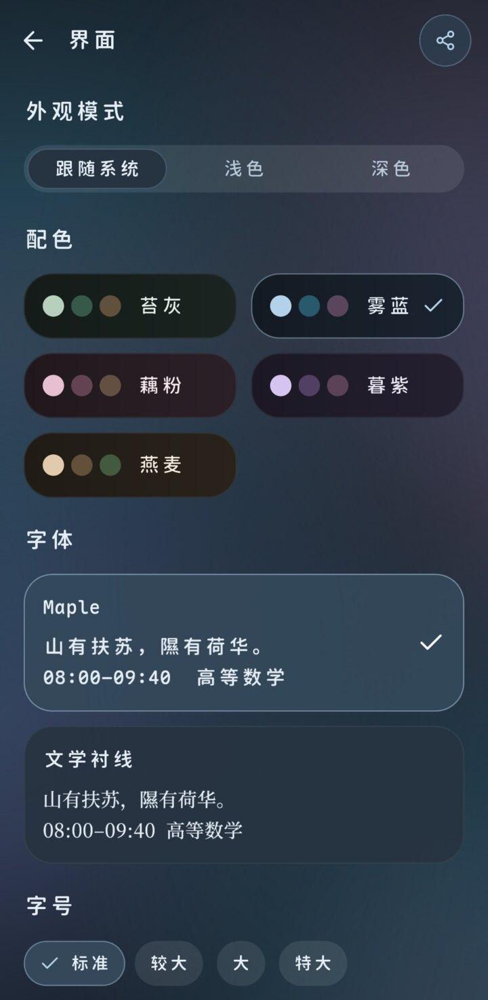

<div align="center">

# SuperXD

课表、成绩一屏看清，和同学互看课表找共同空闲。

非官方的开源校园应用，对接山东现代学院的 Kingo 教务系统；另带不用登录教务的百宝箱：驿站取件、学习通签到、短视频解析。

[](https://github.com/huverse/SuperXD/releases)
[](https://github.com/huverse/SuperXD/releases)
[](https://flutter.dev)
[](https://github.com/huverse/SuperXD/actions/workflows/ci.yml)
[](LICENSE)

**[下载 APK](https://github.com/huverse/SuperXD/releases) · [常见问题](docs/faq.md) · [反馈问题](https://github.com/huverse/SuperXD/issues) · [更新记录](CHANGELOG.md)**

</div>

> [!WARNING]
> 当前是 **Alpha 测试版**：功能和数据可能出错，课表与成绩请以学校系统为准。本应用不是学校官方应用，与学校没有隶属或合作关系。

<table>
  <tr>
    <th>此刻在上哪节课</th>
    <th>按学期翻周看课表</th>
    <th>绩点与每门成绩</th>
  </tr>
  <tr>
    <td></td>
    <td></td>
    <td></td>
  </tr>
  <tr>
    <th>和好友找共同空闲</th>
    <th>驿站待取件按手机尾号分组</th>
    <th>深色与配色</th>
  </tr>
  <tr>
    <td></td>
    <td></td>
    <td></td>
  </tr>
</table>

截图来自 Android 模拟器，课程、教师、成绩、好友、快递与取件码都是虚构的演示数据（[tool/readme_demo.dart](tool/readme_demo.dart)）。

## 亮点

- **此刻在上哪节课**：打开就是今天，顶部写着正在上的课、教室和几点下课，到点自动切到下一节；课上完了预告下一节在哪天几点。
- **课表自己能改，改错能恢复**：天、学期、学年三种视图；增删改课程，每次改动都留历史版本；导出到系统日历、课前提醒，桌面小组件不打开应用也能看。
- **成绩一屏看全**：按学年或学期看成绩、学分与绩点，搜索加筛选。
- **和同学互看课表**：扫码加好友，分享课表后直接列出两人的共同空闲，也能分享界面配置和短视频；内容端到端加密，不做文字聊天。
- **百宝箱**：不用登录教务。拼多多驿站待取件与取件身份码、学习通签到、短视频解析与下载，详见 [百宝箱说明](docs/toolbox.md)。
- **好看也好调**：四套配色、浅色与深色、两种字体、按屏宽标出推荐范围的字号条、液态玻璃和自定义背景。
- **教务只在你点的时候同步**：平时只读本机数据；同步失败时保留本机数据，不会误清空。

## 下载与安装

1. 从 [Releases](https://github.com/huverse/SuperXD/releases) 下载最新的 APK：大多数手机选 `arm64-v8a`，较老的 32 位手机选 `armeabi-v7a`。需要 Android 11 或更高版本。
2. 想确认安装包没被篡改：用同页的 `SHA256SUMS` 核对文件，再用 `apksigner verify --print-certs SuperXD-<版本>-arm64-v8a.apk` 查看签名，证书的 SHA-256 指纹应为：

   ```text
   83:7A:2E:88:57:13:1D:BC:E2:54:16:9D:C1:28:92:A6:AC:77:07:36:2C:71:BC:F5:91:EB:37:D0:B6:22:4A:3F
   ```

3. 第一次打开先阅读并同意用户协议与隐私政策（同意之前应用不联网），再用本人的教务账号登录，在「今天」页点「同步」，按提示设置开学日。
4. 之后应用每天检查一次新版本，点「更新」在应用内下载，核对签名后交给系统安装。

iPhone（iOS 16 及以上，测试中）：Releases 里附有未签名的 `SuperXD-<版本>-ios-unsigned.ipa`，没有上架 App Store，要用你自己的证书签名后安装（例如全能签）。有新版本时应用会提示并打开发布页，下载后重新签名安装。证书只绑一个固定应用 ID 时签不了小组件与实时活动的扩展，在签名工具里去掉插件再装即可；iOS 上做法不同的地方见隐私政策附录四。

遇到问题先看 [常见问题](docs/faq.md)。

## 隐私与安全

- 不含广告和崩溃上报，开发者不做行为统计。扫码用的 Google ML Kit 会向 Google 发送匿名的用量统计（设备型号、系统版本、耗时与错误码等），扫码画面与内容不上传。
- 教务账号、课表和成绩只在本机与学校教务系统之间传输，开发者收不到。学校教务系统目前只有 HTTP 明文连接，请只在可信网络登录。勾选「记住账号」后，凭据加密存进系统安全存储，可随时关闭。
- 开发者只运营一台自建中转服务器，用于私信、学习通代签凭据包暂存、检查更新、「开发者的话」和节日抽奖。私信在本机加密（X25519 + AES-256-GCM），代签凭据包用一次性密钥加密，服务器只看得到密文；抽奖只用随机生成的参与号。测试期中转为 HTTP 明文，设备号、好友关系等元数据对网络中间方可见。服务端源码在 [server](server)。
- 百宝箱的工具会把必要的信息交给第三方（解析服务、超星学习通、拼多多、高德等），每个工具第一次使用前单独征得你的同意。学习通签到为算设备码会读取匿名设备标识 OAID，为此集成了开源的 Android_CN_OAID 及它带入的华为、荣耀广告标识 SDK（闭源，只读 OAID，不用于广告）。
- 日志只存在本机、不上传；打开开发者模式后才详细记录，导出由你自己操作。
- 完整的隐私政策在应用内「我的 › 关于 › 隐私政策」，先摘要、再按功能说明，末尾列出第三方 SDK、系统权限与保存期限（源文件 [lib/page/legal_page.dart](lib/page/legal_page.dart)）。政策有实质变化时，升级后打开应用会提示一次。

安全问题请不要公开提交 Issue，使用 GitHub 的 [私密漏洞报告](https://github.com/huverse/SuperXD/security/advisories/new)。

## 从源码构建

需要 Flutter 3.47.2（Dart 3.13.2）与 Android SDK，依赖锁定在 `pubspec.lock`。

```sh
git clone https://github.com/huverse/SuperXD.git
cd SuperXD
flutter pub get --enforce-lockfile
flutter analyze
flutter test
flutter run
```

默认构建开发包（包名 `com.superxd.superxd`），可以和 Releases 里的 SuperXD Alpha 同时安装，数据不共享。两个可选的构建参数，不传时对应功能不可用，其余不受影响：

| 参数 | 用途 |
| --- | --- |
| `--dart-define=SUPERXD_RELAY=http://地址:端口` | 中转服务：私信、学习通代签、应用内更新等 |
| `--dart-define=SUPERXD_AMAP_KEY=<key>` | 学习通位置签到的高德地图；key 要绑定本机调试签名的 SHA1 与包名，调试与发布签名各申请一个 |

中转服务（NestJS + MySQL + Redis）的开发、测试与部署见 [server/README.md](server/README.md)；发布签名、版本与发行流程见 [CONTRIBUTING.md](CONTRIBUTING.md)。

<details>
<summary><strong>仓库目录</strong></summary>

```text
lib/
  domain/       领域类型、端口与规则（纯 Dart）
  edu/          教务协议与页面解析
  local/        本机存储（SQLite、显示设置、更新与协议记录、本机日志）
  gateway/      账号生命周期与教务网关
  application/  同步、课前提醒、小组件、应用更新编排
  device/       系统通知、桌面小组件、应用更新等适配
  social/       私信身份、好友与中转客户端
  toolbox/      百宝箱（短视频解析、学习通签到、快递）
  page/         页面
  theme/        主题、玻璃与动效组件
server/         中转服务（私信、代签暂存、应用更新、开发者的话、节日抽奖）
android/        Android 宿主（小组件、导出与安装通道）
ios/            iOS 宿主（系统组件、导出与通知通道，小组件与实时活动扩展）
test/           自动化测试（只用合成数据）
tool/           手动验证、截图与发版入口，不进 CI
docs/           百宝箱说明、常见问题与 README 截图
```

依赖只许自上而下，由 `test/project_structure_test.dart` 检查。各目录的 `CLAUDE.md` 是项目索引，记录文件职责与跨模块约定。

</details>

## 参与开发

欢迎提交 [Issue](https://github.com/huverse/SuperXD/issues) 和 Pull Request。改动前请读 [CONTRIBUTING.md](CONTRIBUTING.md)：功能在短分支开发、通过 CI 后合并；测试与截图只用合成数据，不要提交真实账号、课表、成绩、Cookie 或日志。

反馈问题时请写明应用版本、手机型号与系统版本、操作步骤和看到的提示，截图记得遮住学号姓名；可以附上开发者模式导出的日志（做法见 [常见问题](docs/faq.md)）。也可以联系开发者：QQ 209320162，邮箱 vbhcchhvvvhh@gmail.com（涉及个人信息的请求请走这里，不要发在公开 Issue）。

## 许可与声明

SuperXD 以 [GNU GPL v3.0](LICENSE) 开源，版权所有 (C) 2026 Galaxyous。修改和再分发时请保留版权与许可说明，并按 GPL 提供对应源码。

以下部分不随本项目以 GPL 授权：

- `lib/theme/curve_geometry.dart` 中的曲线加载动画改编自 [Paidax01/math-curve-loaders](https://github.com/Paidax01/math-curve-loaders)，上游未附开源许可，本项目已获作者授权使用。再分发本项目或其修改版时，请自行取得授权，或移除、替换这部分代码。
- 内置字体 Maple Mono NF CN 与 Noto Serif SC 按 SIL Open Font License 1.1 分发。
- 测试期临时图标（android/app/src/main/res 下的 ic_launcher 与 ic_launcher_background，以及“关于”页用的 assets/app_icon.png）使用动画《Charlotte》角色画面，版权归原权利人所有（©VisualArt's/Key/Charlotte Project），仅供测试期间临时使用，正式版前替换为原创图标。
- 开屏画作（assets/paintings 下的图片）由本项目作者用 AI 生成（仿莫奈风格），版权所有 (C) 2026 Galaxyous，保留所有权利，仅随本应用分发，可在应用里存作个人壁纸；再分发本项目或其修改版时，请移除或替换这些画作。
- 其他第三方组件按各自许可使用，清单见 [assets/third_party_notices.txt](assets/third_party_notices.txt)，或应用内「我的 › 关于 › 开源许可」。

本项目与学校、Kingo 教务系统、超星学习通、拼多多及短视频平台均无关联。短视频解析依赖第三方服务，请只处理本人或已获授权的作品；学习通签到与快递请只用于本人或已获授权的账号，代签会替代他人出勤，是否合规由你和学校的规定决定。
