<!--
[人工决策-2026-11-23 23:57:01] README 全面重写（用户：放弃原来的风格，参照大厂与前沿开源项目；所有功能都要介绍、分轻重；不隐瞒、不缺漏）。
功能轻重由用户定：第一档（首屏总表前两行、每项配截图）今天课表与成绩、住理生活、快递与取件身份码、学习通签到、视频解析、电影院、侧栏与搜索；
第二档（展开写）私信与共同空闲、游乐场、教务同步、提醒小组件与日历、应用账号与联网偏好、外观；第三档写进「更多」；没启用、框架在的只写进「现状与已知限制」。
截图只用 tool/readme_demo.dart 的合成数据，海报与封面用本项目自己的开屏画作。加功能时按这个分档放，改功能时同步改对应小节、限制与数据去向。
-->
<div align="center">

# SuperXD

**把校园里要用的，装进一个应用。**

课表成绩、宿舍洗浴、驿站取件、课堂签到、视频下载、在线影视、和同学互看课表、益智游戏。<br>
个人开发的非官方开源应用；数据默认留在你的手机上。

[](https://github.com/huverse/SuperXD/releases)
[](https://github.com/huverse/SuperXD/releases)
[](#ios)
[](https://github.com/huverse/SuperXD/actions/workflows/ci.yml)
[](LICENSE)

[下载](#下载与安装) · [功能](#功能一览) · [现状与限制](#现状与已知限制) · [隐私与数据](#隐私与数据去向) · [常见问题](docs/faq.md) · [更新记录](CHANGELOG.md)

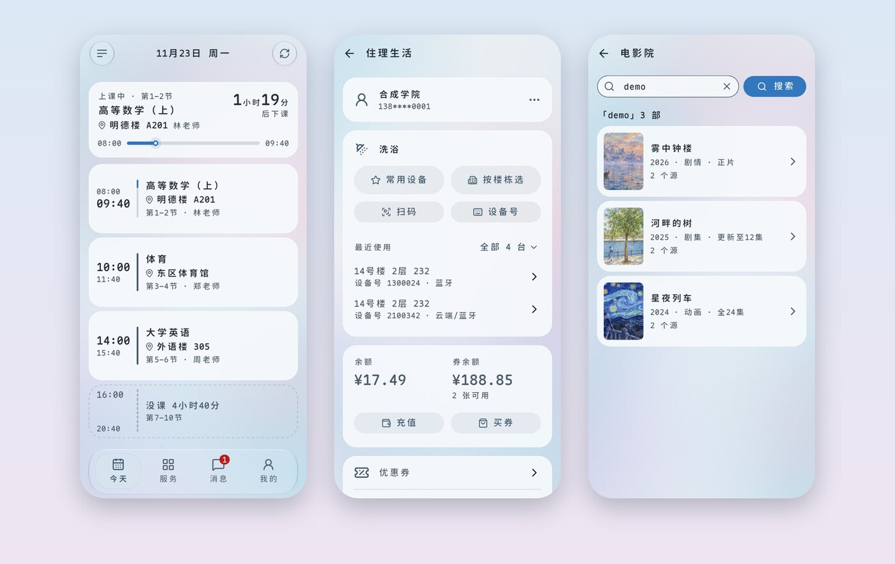

</div>

> [!IMPORTANT]
> **公开测试中（Alpha），非官方。** 功能和数据可能出错，课表与成绩以学校系统为准。SuperXD 与学校、Kingo、超星学习通、拼多多、住理生活、胖乖生活、支付宝、视频平台和影视片源站都没有隶属或合作关系。快递、住理生活、学习通签到模仿官方客户端的请求，用的是对方没有公开的接口，对方一调整就可能失效。

<details>
<summary><strong>目录</strong></summary>

- [功能一览](#功能一览)
- [功能](#功能)：[今天、课表与成绩](#今天课表与成绩) · [住理生活](#住理生活) · [快递与取件身份码](#快递与取件身份码) · [学习通签到](#学习通签到) · [视频解析](#视频解析) · [电影院](#电影院) · [侧栏与搜索](#侧栏与搜索) · [私信与共同空闲](#私信与共同空闲) · [游乐场](#游乐场) · [教务同步](#教务同步) · [提醒、小组件与日历](#提醒小组件与日历) · [应用账号与联网偏好](#应用账号与联网偏好) · [外观](#外观) · [更多](#更多)
- [现状与已知限制](#现状与已知限制)
- [下载与安装](#下载与安装)
- [隐私与数据去向](#隐私与数据去向)
- [安全](#安全)
- [谁在开发、成本谁出](#谁在开发成本谁出)
- [技术架构](#技术架构)
- [从源码构建](#从源码构建)
- [参与与反馈](#参与与反馈)
- [致谢](#致谢)
- [许可与声明](#许可与声明)

</details>

## 功能一览

SuperXD 一开始只是看课表和成绩的客户端，现在是一个校园全能应用。除了学业，其他功能都不用登录教务。

| | | | |
| :-- | :-- | :-- | :-- |
| **[今天、课表与成绩](#今天课表与成绩)**<br>此刻在上什么课、几点下课 | **[住理生活](#住理生活)**<br>宿舍洗浴扫码开水、充值买券 | **[快递与取件身份码](#快递与取件身份码)**<br>驿站待取件、全屏出示身份码 | **[学习通签到](#学习通签到)**<br>五种签到、多人连签与代签 |
| **[视频解析](#视频解析)**<br>粘贴链接解析、预览、下载 | **[电影院](#电影院)**<br>多个片源一起搜、换源接着看 | **[侧栏与搜索](#侧栏与搜索)**<br>一滑直达常用，下拉搜索全部 | **[私信与共同空闲](#私信与共同空闲)**<br>互发课表，找两人都空的时间 |
| **[游乐场](#游乐场)**<br>17 个益智游戏、每周挑战 | **[教务同步](#教务同步)**<br>手动为主，冲突时逐项挑 | **[提醒、小组件与日历](#提醒小组件与日历)**<br>课前提醒、灵动岛、桌面小组件 | **[应用账号与联网偏好](#应用账号与联网偏好)**<br>自有账号，可选「仅本机」 |
| **[外观](#外观)**<br>配色、深浅色、字体、字号、玻璃 | **[更多](#更多)**<br>开屏画作、快捷入口、应用内更新… | | |

每项要什么账号、数据发给谁，在对应小节和[隐私与数据去向](#隐私与数据去向)里都写明了。截图来自安卓模拟器，课表、成绩、账号、快递、设备、影片与视频全是 [tool/readme_demo.dart](tool/readme_demo.dart) 里的合成数据；海报与视频封面用的是本项目自己的开屏画作。

## 功能

### 今天、课表与成绩

<p>
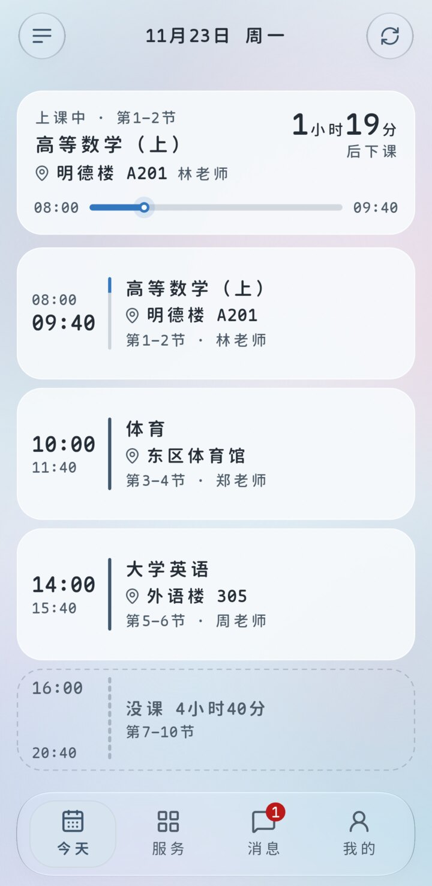
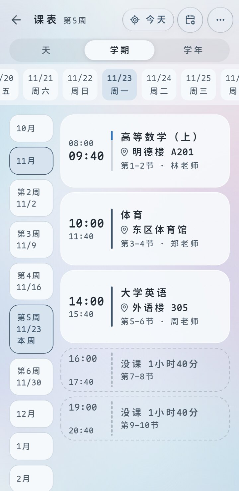
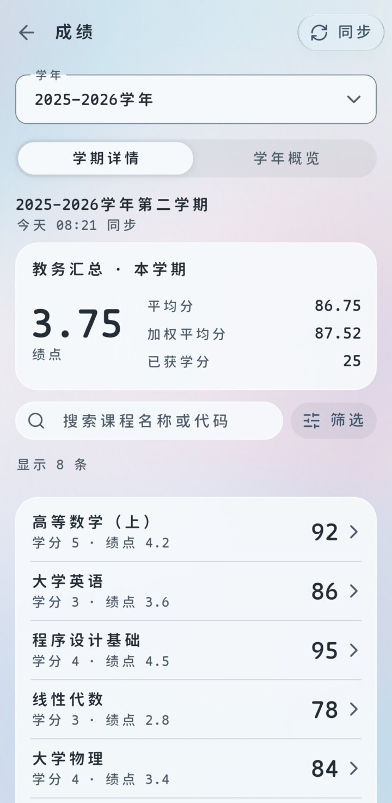
</p>

要用本人的教务账号登录（目前只适配山东现代学院的 Kingo 教务）。

- **今天**：顶部「此刻」卡写着正在上的课、教室、老师和几点下课，进度条跟着走；开课前 15 分钟突出倒计时，最后 5 分钟按秒倒数，到点自动切到下一节；当天的课上完了，预告下一节在哪天几点。上下拖动看前后几天。
- **课表**：天、学期、学年三种视图，标题旁写第几周，学期视图的月份与周次栏在窄屏、大字号下收成一行横条；第几周从你设的开学日算起，单击课程看详情。
- **成绩**：按学年或学期看成绩、学分与绩点，以及教务给的平均分、加权平均分；有效成绩和原始成绩（平时、期末等）都能看；一行搜索加筛选、排序，不及格单独标出。

### 住理生活

<p>
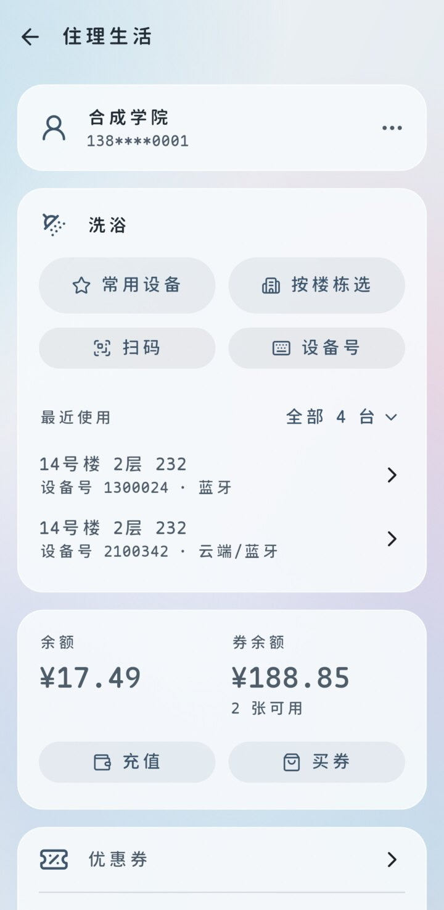
</p>

在百宝箱的「生活」里，对接学校宿舍的洗浴水控「住理生活」。用你本人的住理生活账号。

- **登录**：手机号加 6 位数字密码，住理要图形验证码时当场输；可以登录几个账号切换；忘了密码用短信验证码重设。
- **洗浴**：扫设备上的二维码、输设备号、从常用设备里点，或者按楼栋、楼层、房间选。开水前按住理官方 App 的顺序查一遍（设备状态、待支付的单、余额门槛、供水时段），写明余额、券余额和预扣多少。只有蓝牙的设备由手机连上它，转发住理发来的开关指令；云端和蓝牙都有的设备可以自己选走哪一路；蓝牙设备找不到时列出同房间的其他设备，一键换过去。洗着澡退出了页面，回首页点「正在用水」接着关水。
- **充值与买券**：用支付宝付款。充值可以点住理给的几档，也可以输 0.01–500 元的任意金额；买券看售价、面额、限购和剩余。付完回到应用去住理查到账，以住理为准。
- **余额、优惠券与订单**：每张券能按月看抵扣记录，消费与充值订单都能看详情；这些都是现查，不在手机上保存。
- 最近使用自动记 6 台设备，常用设备收藏 20 台，都只存本机。长按应用图标的「扫码洗浴」一步打开扫码。

### 快递与取件身份码

<p>
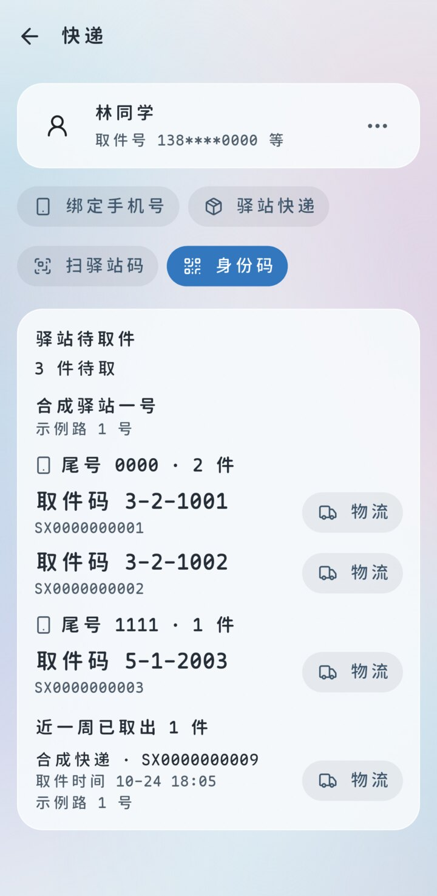
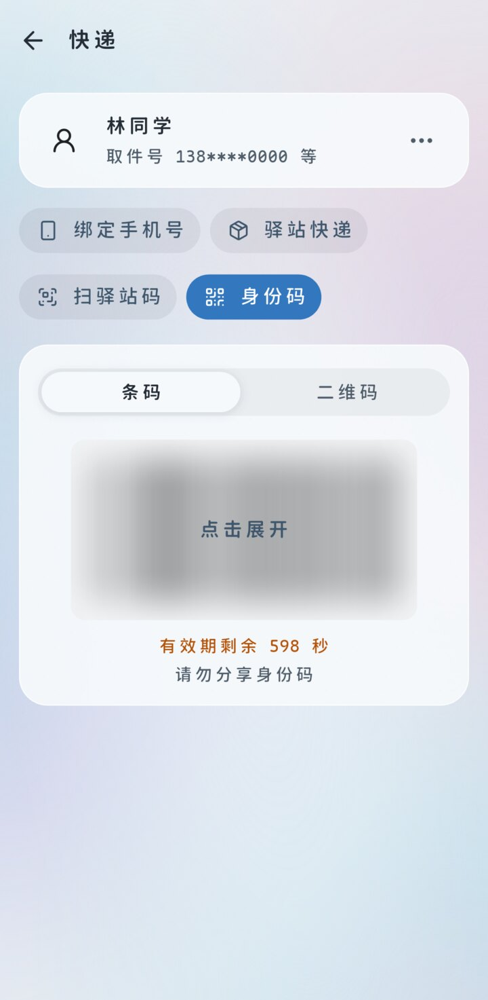
</p>

用拼多多账号查驿站里的快递。

- **驿站待取件**：按驿站列出，同一个驿站里按寄到的手机尾号分组，取件码写得最醒目；每件都能看物流；下面列近一周已取出的件。扫驿站贴的码，只查这一个驿站。
- **取件身份码**：条码和二维码两种，到期自动换新。平时盖着一层朦胧的遮罩，点开全屏出示，屏幕调到最亮（条码转 90° 沿长边铺开，方便驿站高拍仪扫）。长按应用图标选「取件身份码」，或在身份码卡上「添加到桌面」，一步打开。
- **取件手机号**：查看、绑定（短信验证）、解绑和写备注，每一步都由你确认；绑定后按拼多多的流程，把这个号已到站的快递关联进账号。
- 登录用手机号加短信验证码，也可以改用拼多多官方网页登录；拼多多要安全验证时打开它的官方验证页，由你本人完成；只能用微信查询的账号会写明并引导去微信。
- 拼多多同一个账号不能多台设备同时在线，在这里登录会让其他设备上的拼多多下线，建议用小号登录，再绑常用的手机号。

### 学习通签到

<p>
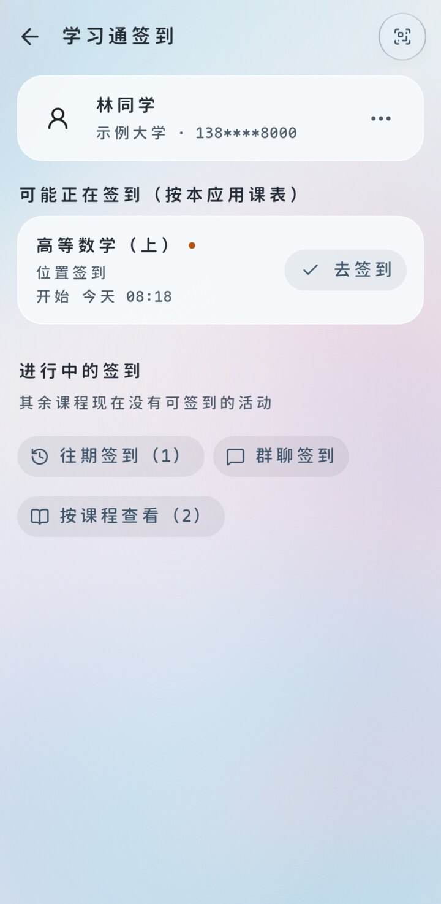
</p>

用你自己的超星学习通账号，在应用里完成课堂签到。

- **五种签到**：签到码、手势、位置、拍照、二维码，另有签退、人脸识别、群聊签到、往期补签与按课程查看。二维码签到可以连续扫码，扫到就提交。
- **可能正在签到**：按本应用里的课表推断正在上的课，把这节课里的签到放在最上面；比对只在本机做，不发给学习通。
- **位置签到**：在网页版高德地图上点选位置，默认这门课上次签到用的位置；老师设了签到点时画出范围。也可以收藏常用位置或手输坐标。
- **多个账号**：可以设主账号、备注名、标签、拖动排序；签到时勾选几个账号依次签完（多人连签）。设置里可以选学校单位（挂了几个单位时）、推断用哪份课表和模拟的客户端；人脸照片存在你自己的学习通云盘里。
- **代签**：被代签的人在自己的手机上出示「代签码」（二维码，10 分钟有效、被扫走即失效），帮签的人扫码，把对方的账号导入到自己的手机上；之后可以单独替对方签，也可以和自己的账号一起多人连签。账号凭据在出示的手机上用一次性密钥加密，密钥只在二维码里；密文经开发者的服务器暂存、取走即删，服务器看不到内容；导入的账号用对方手机的设备码登录。
- 滑块验证先在本机自动识别缺口，认不准再请你手动拖。
- 签到只是把你在学习通上要做的事搬到这里做，迟到、超范围依旧按学习通的规则判；代签会替代他人出勤，是否合规由你和学校的规定决定，后果由使用者自行承担。

### 视频解析

<p>
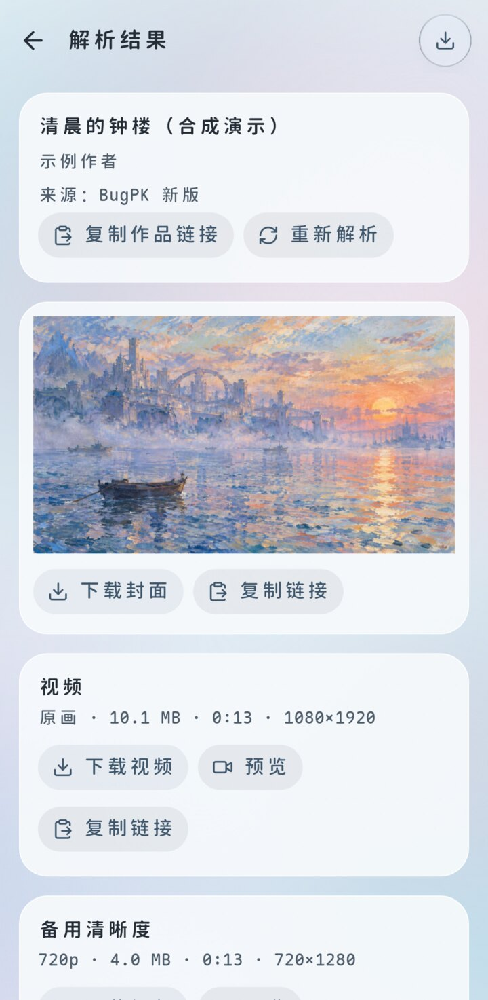
</p>

- 粘贴作品的分享文案或链接，解析出视频或图集（支持 30 多个平台），写出来源给的画质、大小、时长和分辨率；预览后下载，进度原地显示，可暂停、继续。
- 下载的文件存到 Download/SuperXD（iOS 存进相册），归你所有，卸载应用也不删。
- 解析依赖第三方服务 BugPK（新版与旧版两个接口），每个来源第一次用之前单独征得同意；自动模式按顺序试已同意的来源。
- 解析历史只存本机（最多 80 条、30 天，可以关掉）；可以把作品分享给私信好友，只发原链接和标题，对方在自己的手机上重新解析。
- 请只处理本人或已获授权的作品。

### 电影院

<p>
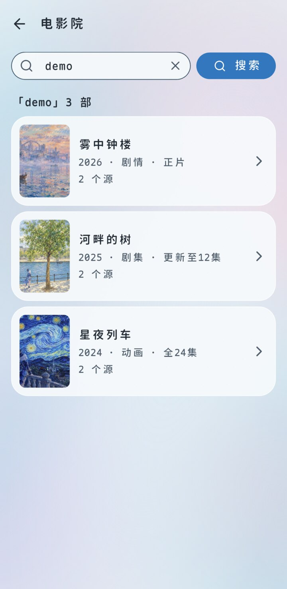
</p>

- **搜片**：一次问遍规则里的片源站，哪个先回来先显示；结果写年份、分类与备注，同名的预告片、解说单独一条；没搜成的片源按「连不上」「拒绝访问」「出错」分组列在「暂不可用」。
- **看片**：同一部片在各片源的版本合成一条；选集，换源时停在同一集，原来的片源坏了可以「找其他片源」；看过的记录（看到哪一集哪一分钟）只存本机，从「看过的」接着看。
- **播放器**：安卓默认用 ExoPlayer，可以换成 mpv（打不开的片源自动改用 mpv）；iOS 用 mpv。双击暂停、长按倍速、左右滑调进度、上下滑调亮度与音量，全屏时转成横屏；可调倍速与画面比例，自动播下一集。打开选集时先备好要看那一集，快播完时先取下一集，点播放更快。
- **数据去向**：片源与画面全部来自第三方站点，版权归原权利人；第一次搜索前列出要用的片源站，你同意才发片名。搜索、选集与播放都在手机上直连片源。不支持按片名搜索的片源站，片名先发到开发者的服务器查影片编号（不保存）；国内连不上的片源站，搜索与选集请求经开发者部署在 Cloudflare 上的境外转发转交（片名与 IP 地址会到境外，不保存、不记录）。
- 片源自带的插播广告不去掉；「解析」（粘贴视频网站的播放页地址来播放）暂时没有开放。

### 侧栏与搜索

<p>
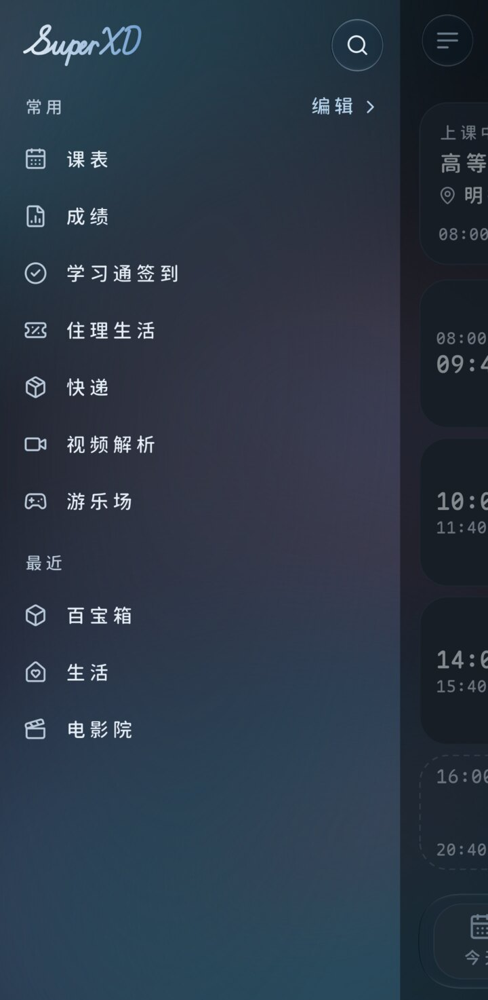
</p>

- 在今天页从左往右滑，或点左上角，拉出侧栏。常用的页面与功能自己勾选、拖动排序，最近进过的 5 个自动记住。
- 在列表顶上往下拉，进入搜索，按名字和别名找学业、百宝箱、游乐场与设置里的页面和功能。
- 常用与最近只存本机。

### 私信与共同空闲

<p>
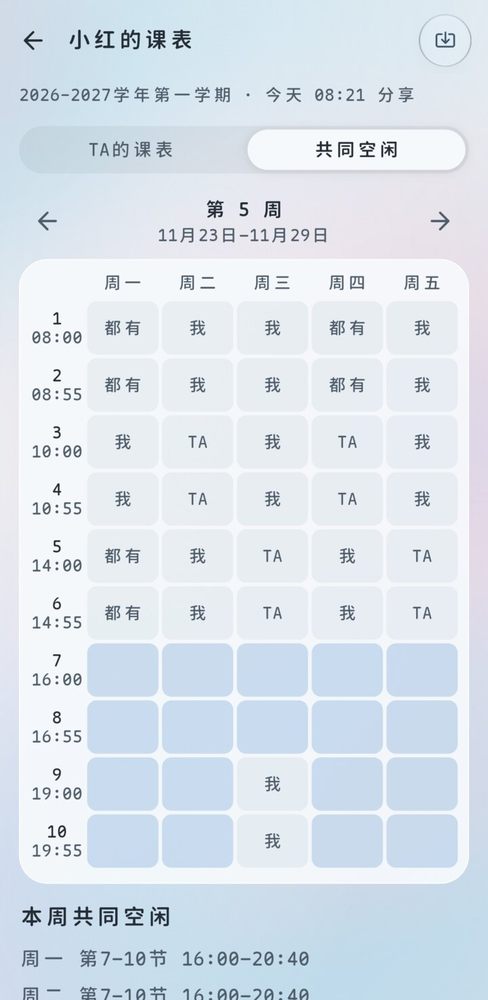
</p>

- 扫码互加好友，互发**课表**和**短视频**卡片，没有文字聊天。
- 收到好友的课表，可以看两人的「共同空闲」，也可以逐项（比如只改教室）或整份导入自己的课表，导入前的版本留在历史里。
- 线上私信在手机上端到端加密（X25519 + AES-256-GCM），经开发者的服务器转交，需要登录应用账号；只在应用打开时收取，没有后台推送；换手机后可以把私信接管到新手机（旧手机上的记录不会过来）。
- **面对面**：两人都打开消息页的「面对面」时，经蓝牙直接互发同样的卡片，不经服务器、不用登录。

### 游乐场

<p>
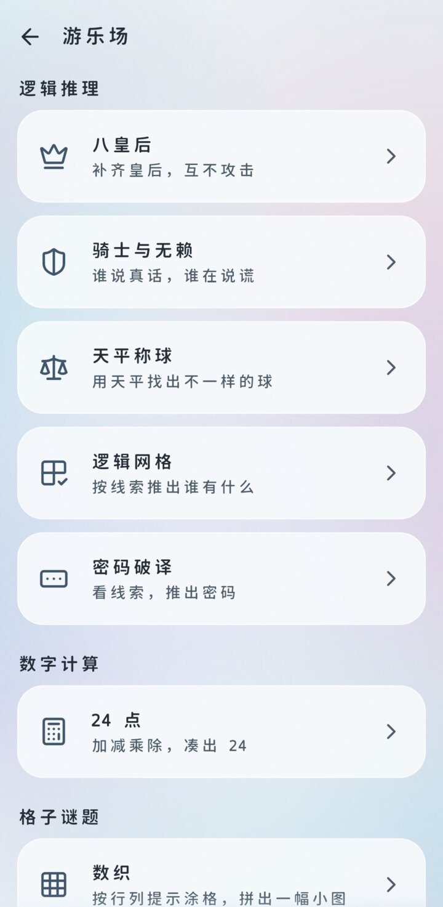
</p>

- 17 个益智游戏，分逻辑推理、数字计算、格子谜题、移动与规划、记忆与反应、物理六类：八皇后、骑士与无赖、天平称球、逻辑网格、密码破译、24 点、数织、扫雷、数回、点灯、推箱子、冰面滑行、汉诺塔、过河问题、记忆闪光、舒尔特方格、画线入杯。每个都有入门到专家五档难度，不用登录，最好成绩只存本机。
- **每周挑战**：登录应用账号后参加，题目由服务器出、逐关核对、计时，成绩换成积分；有的挑战要花积分买门票。
- **积分与等级**：积分满 12 个月过期，按近 12 个月得到的积分分为 Lv0 到 Lv5；等级越高，新功能、新版本越早轮到你，节日抽奖也按等级加权（有封顶）。积分不能充值，也不能换钱。
- 游乐场与积分的数据可以在应用账号页一键删除（登录着且联网时连服务器上的一起删）。

### 教务同步

- 默认只在你点「同步」时访问教务，可以选学年和内容；也可以在「服务 › 学业」开启后台自动同步（默认关），设间隔、学年和内容。教务没给这学期的作息时，要你确认才采用别的学期的作息。
- 同步失败时一律保留本机数据：只有教务明确返回「没课」「没成绩」才当空结果。
- 你改过课表、教务又变了时不直接覆盖：逐项列出谁改了什么，默认只勾教务改的，也可以整份二选一；自动同步遇到冲突留到你方便时再问。
- 每一轮同步都留一条同步记录，写清改了什么；课表的变化可以一键撤回；自动同步发现课表或成绩有变化时发通知（如「新出了 2 门成绩」），点开就是这条记录。

### 提醒、小组件与日历

- **课前提醒**：按学期设开关与提前时间（5、10、15、30 分钟）。安卓 16 起可以开「状态栏胶囊」，开课前到下课在状态栏倒计时（OPPO 上是流体云）；iOS 有实时活动与灵动岛上课倒计时。
- **桌面小组件**：安卓与 iOS 都有，不打开应用也能看今天和之后几天的课，配色跟着应用。
- **导出到日历**：把一学期的课写成 .ics 交给系统日历，重复导入时更新同一事件。

### 应用账号与联网偏好

- **应用账号**是 SuperXD 自己的账号（用户名加密码），和教务账号无关，用于私信、挑战积分、节日抽奖和认领诊断包。密码与恢复码在手机上用服务器公钥封装后才发出，服务器只存不可逆哈希；忘了密码用恢复码重设，新手机用已登录的手机扫码登录；可以随时注销，服务器上这个账号的数据一并删除。没有人工找回，也没有客服。
- **联网偏好**：在应用账号页改成「仅本机」，应用账号、经服务器的私信、挑战积分与解锁、节日抽奖和健康回报都不再联网，本机数据照常保留；改回「联网」接着用。

### 外观

- 四套配色（雾蓝、藕粉、暮紫、燕麦）、浅色与深色、三种字体（Maple、系统字体、选用时才下载的文学衬线）。
- 字号条上的数就是实际显示大小，默认跟随系统，条下标出这台手机的推荐范围，超出时说明哪些页面会改排。
- 液态玻璃有自动、完整、简化、关闭四档；可以用相册里的一张图做背景。

### 更多

- **课表编辑与历史版本**：自己增删改课程，同名不同老师的教学班合成一门编辑；每次改动都留历史版本，可以恢复到任何一版。
- **多个教务账号**：切换账号、可选的「记住账号」（凭据只进系统安全存储，开着时登录过期会自动重新登录一次）、导入旧版本的数据。
- **开屏画作**：每次打开先看到一幅画，天空里一笔写出「SuperXD」，轻点立即进入；可以排播放顺序、存到相册。
- **快捷入口**：长按应用图标有「取件身份码」「扫码洗浴」，也能添加到桌面。
- **应用内更新**（安卓）：每天检查一次，点「更新」在应用里下载，核对包名、版本与签名后交给系统安装；新版本可能分几天推完。iOS 检查到新版本时打开发布页。
- **开发者的话**：开发者写给大家的信，在你不忙的时候弹出一次，信里可能附红包。
- **节日活动**：节日当天在你不忙的时候播一段庆祝动画，有的节日可以抽支付宝红包（要登录应用账号，每人每次活动抽一次）。
- **开发者模式**：在「关于」里连点版本号 7 次打开，详细记录日志，页面上多一个悬浮的开发者工具（标记页面、看日志、性能浮层）；日志可以导出，或加密后上传诊断包、凭编号联系开发者，登录着应用账号时传的记在账号下，可以自己删。开发者模式不改任何业务行为。
- **新版本反馈**：装了新版本 14 天内，「关于」里可以说一句好不好用（匿名）。
- **扫码**：加好友、课堂签到、驿站码、洗浴设备码都在手机上识别，不联网，可以两指缩放或从相册识别。

## 现状与已知限制

以下按 1.0.0-alpha.40（2026-11-23）写。

- **阶段**：个人开发的 Alpha 公开测试版，2026-10 起公开。验证以安卓模拟器为主，只在少数真机上走过部分功能；没有 Mac，iOS 只在 CI 里编译、在模拟器上冒烟，iOS 上的结论只靠测试者的 iPhone 回报。
- **只适配一所学校**：教务只对接山东现代学院的 Kingo 系统，换校要改源码；教务只有 HTTP 明文连接，请只在可信网络登录。
- **住理生活**：只在一所学校实测过，云端和蓝牙都有的设备两路都开关过水，真实充值也到账了。抽样里大多数设备只有蓝牙，这类设备还没在真机上开过水；iOS 上支付宝付完跳回应用也还没验过。
- **胖乖生活**：百宝箱「生活」里的第二个子模块（共享洗衣机、吹风机扫码或按附近门店找到后下单、用支付宝付款，饮水机锁机取水与水卡充值），碰真钱，开关默认关、只点名给开发者测；真实账号与真机还没走过，人机验证（网易易盾）、系统定位与支付宝都只有真机能验。
- **非公开接口**：快递（拼多多）、住理生活、胖乖生活、学习通签到都在模仿官方客户端的请求，对方一调整就可能失效，不保证一直能用。
- **电影院**：能搜到什么、能不能播，取决于第三方片源站；片源自带的广告不去掉；「解析」暂未开放。
- **私信**：没有后台推送，只在应用打开时收取。
- **还没启用的**：积分换电影院时长的「时长券」代码已经预接，还没启用；积分解锁（隐藏功能、新游戏抢先玩）的机制已上线，目前没有上架的项目；节日登记表目前是空的。
- **灰度**：新功能可能先按比例、积分等级或点名开给一部分人，配置在开发者手里、不在公开仓库；目前（alpha.40）灰度中的功能都已全量开放。
- **图标**：测试期图标用的是动画角色画面，版权不属于本项目，正式版前会换成原创图标。
- **平台**：Android 10 及以下装不了（系统自带的 SQLite 太旧）；iOS 需要 16 起、自己签名安装；没有上架任何应用商店。

## 下载与安装

### Android

1. 从 [Releases](https://github.com/huverse/SuperXD/releases) 下载：大多数手机选 `arm64-v8a`，老的 32 位手机选 `armeabi-v7a`，`x86_64` 给模拟器用。需要 Android 11 及以上。
2. 想确认安装包没被篡改（可选）：
   - 用同页的 `SHA256SUMS` 核对：`sha256sum -c SHA256SUMS`
   - 查签名：`apksigner verify --print-certs SuperXD-<版本>-arm64-v8a.apk`，证书 SHA-256 应为<br>`83:7A:2E:88:57:13:1D:BC:E2:54:16:9D:C1:28:92:A6:AC:77:07:36:2C:71:BC:F5:91:EB:37:D0:B6:22:4A:3F`
   - 查来源：装好 [GitHub CLI](https://cli.github.com/) 后运行 `gh attestation verify <文件名> -R huverse/SuperXD`，确认出自本仓库的发版流水线。
3. 第一次打开先读并同意用户协议与隐私政策，同意之前应用不联网。要用学业就登录本人的教务账号、点「同步」、按提示设开学日；只用百宝箱、游乐场或私信可以不登录教务。
4. 之后在应用里更新即可；也可以下载新版直接覆盖安装，签名相同，数据保留。

### iOS

Releases 里附有未签名的 `SuperXD-<版本>-ios-unsigned.ipa`（iOS 16 及以上），要用你自己的证书签名后安装（例如全能签）。小组件与实时活动在扩展里，证书只绑一个固定应用 ID 时签不进去，在签名工具里去掉插件再装即可。iOS 不能在应用里装更新，检查到新版本时会打开发布页，下载后重新签名安装。iOS 上做法不同的地方见隐私政策附录四。

遇到问题先看[常见问题](docs/faq.md)，各工具的详细说明见[百宝箱说明](docs/toolbox.md)。

## 隐私与数据去向

完整的隐私政策在应用里「我的 › 关于 › 隐私政策」（源文件 [lib/page/legal_page.dart](lib/page/legal_page.dart)），先摘要、再按功能写，末尾列出第三方 SDK、系统权限和每类数据的保存期限。这里是概览：

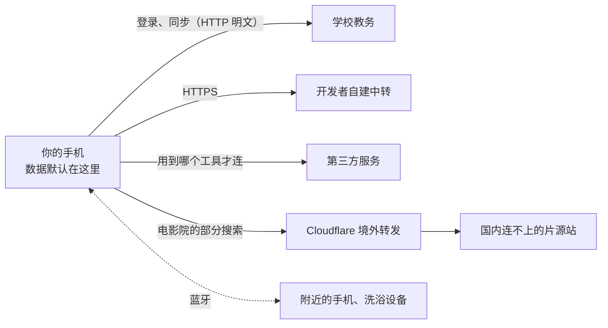

| 去向 | 发什么 | 什么时候 |
| :-- | :-- | :-- |
| 学校教务（HTTP 明文） | 账号、密码、验证码与同步请求 | 登录、点同步、开了自动同步后按间隔 |
| 开发者自建中转（HTTPS） | 私信与代签凭据包（都是本机加密后的密文）；应用账号（密码与恢复码在本机封装，服务器只存哈希）；检查更新、灰度配置、开发者的话、电影院的片源规则与片名查找（片名不保存）、字体下载；挑战与积分、节日抽签；匿名健康回报与新版本反馈；你确认上传的诊断包（加密） | 用到对应功能时；选「仅本机」后社交、积分、抽奖与健康回报都不发 |
| Cloudflare 境外转发 | 电影院向国内连不上的片源站发的搜索与选集请求（含片名与你的 IP 地址） | 用这些片源时；不保存、不记录 |
| 第三方服务 | 超星学习通与环信、拼多多、住理生活、胖乖生活与它的饮水机合作方 apwork.cn、网易易盾（胖乖要人机验证时）、支付宝、BugPK、高德地图（网页版）、电影院的片源站 | 你用对应工具、并同意之后；胖乖生活找附近门店与下单时另发一次手机位置 |
| 附近（蓝牙） | 面对面私信的卡片；住理生活洗浴设备的开关指令 | 打开面对面页、给蓝牙设备开关水时 |

- 教务账号、课表和成绩只在手机和学校之间传，开发者收不到。凭据（教务的「记住账号」、学习通、拼多多、住理生活、胖乖生活、私信私钥、应用账号密钥）只存系统安全存储，不进云备份与换机迁移。
- 不放广告，不接第三方统计或崩溃上报 SDK。安装包里的闭源 SDK 只有四个：支付宝 SDK（只在住理生活、胖乖生活里付款时调起），网易易盾的行为式验证码（只在胖乖生活登录、胖乖要求人机验证时弹出，关掉了它的崩溃与日志上报），华为与荣耀的广告标识 SDK（随开源的 Android_CN_OAID 一起打包，只读 OAID 来算学习通设备码，不用于广告）。
- 日志只存本机：平时只留约 1MB 的错误记录；开发者模式才详细记录；导出、上传都要你自己点。
- 每天一份匿名健康回报（当天升级过的新旧版本各一份）：渠道、版本、这一天有没有致命错误、启动快慢与卡顿的档位，不带账号与设备编号，用来判断新版本要不要暂停推送。
- 删除：退出、关闭「记住账号」、在百宝箱首页清除某个工具的数据，只删本机；关闭私信、注销应用账号会删服务器上对应的数据；各类数据的保存期限见隐私政策附录三。

## 安全

- 安装包始终用同一把签名密钥（指纹见上），安卓会拒绝异签名的覆盖安装；应用内更新另外核对包名、版本号与签名证书。
- 版本清单、开发者的话、灰度配置和电影院的片源规则都用 Ed25519 签名，应用只认内置公钥验得过的内容。
- 和开发者服务器之间走 HTTPS；私信端到端加密，服务器只转交密文。
- 每个发布附件都带 GitHub 的来源证明（attestation）。
- 发现安全问题请用 GitHub 的[私密漏洞报告](https://github.com/huverse/SuperXD/security/advisories/new)，不要公开提 Issue。

## 谁在开发、成本谁出

- 作者是个人开发者 Galaxyous。开发中大量使用 AI 编程助手 Claude Code，绝大多数提交带 `Co-Authored-By` 署名；需求、取舍和发版都由作者决定，关键决定以 `[人工决策]` 注释记在代码里。
- 没有广告、没有收费功能、没有投资。自建中转服务器（一台国内云服务器）和 Cloudflare 上的境外转发由开发者自费运营，节日活动与信里的红包也由开发者个人发放。

## 技术架构

- **客户端**：Flutter（Dart）一套代码，安卓与 iOS 的原生宿主（Kotlin、Swift）负责小组件、实时活动、蓝牙、文件导出与安装更新等。目录即分层，依赖只许自上而下，由 `test/project_structure_test.dart` 检查。
- **服务端**：`server` 目录，NestJS + MySQL + Redis，负责私信转交、应用账号、更新清单、挑战与积分、灰度与健康回报、电影院片名目录等；`server/edge` 是电影院境外转发的 Cloudflare Worker（TypeScript）。
- **质量**：每个 PR 跑四项必需检查：Flutter 静态检查与全量测试（带行覆盖率门槛）、中转服务端测试、安卓构建（带安装包体积预算）、iOS 构建与模拟器冒烟。界面有深浅两套基准图，测试只用合成数据，依赖由 Dependabot 每月更新。
- **发布**：合并带新版本号的提交即自动构建三个安卓架构与 iOS 未签名包，签名版本清单、发布 Release、附来源证明并上传中转。
- 各目录的 `CLAUDE.md` 是项目索引，记录文件职责、模块规则与人工决策的位置。

<details>
<summary><strong>仓库目录</strong></summary>

```text
lib/
  domain/        领域类型、端口与规则（纯 Dart）
  edu/           教务协议与页面解析
  local/         本机存储（SQLite、显示设置、各类本机记录、日志）
  gateway/       账号生命周期与教务网关
  application/   同步、提醒、小组件、更新、灰度等编排
  device/        系统通知、小组件、应用更新、签名验证等适配
  relay/         自建中转的签名请求与应用账号
  social/        私信身份、好友与面对面私信
  toolbox/       百宝箱：short_video（视频解析）、chaoxing（学习通签到）、express（快递）、
                 cinema（电影院）、life/zhuli（住理生活）、life/pangguai（胖乖生活）、download（下载）
  playground/    游乐场的游戏与挑战
  page/          页面
  theme/         主题、玻璃与动效组件
server/          中转服务（NestJS）；server/edge 是 Cloudflare Worker
android/  ios/   原生宿主（ios/CourseWidgets 是小组件与实时活动扩展）
test/            自动化测试（只用合成数据）
tool/            手动验证、截图与发版工具，不进 CI
docs/            百宝箱说明、常见问题与 README 截图
notes/           开发者的话的原文
challenge/       游乐场挑战的公开配置
font_packs/      选用时下载的字体包
```

</details>

## 从源码构建

需要 Flutter 3.47.2（Dart 3.13.2）与 Android SDK，依赖锁定在 `pubspec.lock`。

```sh
git clone https://github.com/huverse/SuperXD.git
cd SuperXD
flutter pub get --enforce-lockfile
flutter analyze
flutter test
flutter run
```

默认构建开发包（包名 `com.superxd.superxd`），可以和 Releases 里的 SuperXD Alpha 同时安装，数据不共享。下面几个构建参数不传时，对应功能不可用，其余照常：

| 参数 | 用途 |
| :-- | :-- |
| `--dart-define=SUPERXD_RELAY=https://地址:端口` | 自建中转：私信、学习通代签、应用账号、应用内更新、电影院片源规则等 |
| `--dart-define=SUPERXD_AMAP_WEB_KEY=<key>` 与 `--dart-define=SUPERXD_AMAP_WEB_SECRET=<安全密钥>` | 学习通位置签到的地图（高德开放平台「Web 端（JS API）」类型的 key，两个一起传） |
| `--dart-define=SUPERXD_SVPARSE_KEY=<key>` | 视频解析的 BugPK 新版来源，不传时只有 BugPK 一个来源 |

中转服务的开发、测试与部署见 [server/README.md](server/README.md)；签名、版本与发版流程见 [CONTRIBUTING.md](CONTRIBUTING.md)；截图入口是 [tool/readme_demo.dart](tool/readme_demo.dart)。

## 参与与反馈

- 欢迎提交 [Issue](https://github.com/huverse/SuperXD/issues) 和 Pull Request。改动前请读 [CONTRIBUTING.md](CONTRIBUTING.md)：一轮改动一条 PR，通过 CI 后合并；测试与截图只用合成数据，不要提交真实的账号、课表、成绩、Cookie 或日志。
- 反馈问题请写明应用版本、手机型号与系统版本、操作步骤和看到的提示，截图记得遮住学号姓名；可以附上开发者模式导出的日志，或上传诊断包后把诊断编号告诉开发者（做法见[常见问题](docs/faq.md)）。
- 涉及个人信息的请求请私下联系：QQ 209320162，邮箱 vbhcchhvvvhh@gmail.com，不要发在公开的 Issue 里。

## 致谢

SuperXD 建立在许多开源项目之上，主要有：

- [Flutter](https://flutter.dev) 与 Dart
- 电影院的规则写法借鉴 [Kazumi](https://github.com/Predidit/Kazumi)（GPL-3.0）
- [media_kit](https://github.com/media-kit/media-kit)（libmpv、FFmpeg）与 video_player（安卓上的 ExoPlayer）
- [liquid_glass_widgets](https://github.com/sdegenaar/liquid_glass_widgets)（液态玻璃）
- [flutter_zxing](https://github.com/khoren93/flutter_zxing) 与 [zxing-cpp](https://github.com/zxing-cpp/zxing-cpp)（本机扫码）
- [bluetooth_low_energy](https://pub.dev/packages/bluetooth_low_energy)（面对面私信与蓝牙洗浴）
- [forge2d](https://github.com/flame-engine/forge2d) 与 [Box2D](https://github.com/erincatto/box2d)（游乐场的物理题）
- [tobias](https://github.com/OpenFlutter/tobias)（支付宝 SDK 的 Flutter 插件）与 [Android_CN_OAID](https://github.com/gzu-liyujiang/Android_CN_OAID)
- background_downloader、sqflite、go_router、flutter_secure_storage、workmanager 等 pub 包
- [Lucide](https://lucide.dev) 图标与 [Morphnext](https://github.com/KickNext/morphnext) 图标形变
- 字体 [Maple Mono NF CN](https://github.com/subframe7536/maple-font)、[Noto Serif SC](https://github.com/google/fonts/tree/main/ofl/notoserifsc)、Newsreader
- [math-curve-loaders](https://github.com/Paidax01/math-curve-loaders)（加载动画，经作者授权）

全部第三方组件与许可见 [assets/third_party_notices.txt](assets/third_party_notices.txt)，或应用里「我的 › 关于 › 开源许可」。

## 许可与声明

SuperXD 以 [GNU GPL v3.0](LICENSE) 开源，版权所有 (C) 2026 Galaxyous。修改和再分发时请保留版权与许可说明，并按 GPL 提供对应源码。

以下部分不随本项目以 GPL 授权：

- `lib/theme/curve_geometry.dart` 中的曲线加载动画改编自 [Paidax01/math-curve-loaders](https://github.com/Paidax01/math-curve-loaders)，上游未附开源许可，本项目已获作者授权使用。再分发本项目或其修改版时，请自行取得授权，或移除、替换这部分代码。
- 字体 Maple Mono NF CN（随安装包）与 Noto Serif SC（选用时从中转下载）按 SIL Open Font License 1.1 分发，都已裁剪到常用汉字与界面符号；侧栏左上角的 Newsreader 斜体同为 OFL，只留「SuperXD」七个字母（见 tool/font_subset.py 与 assets/third_party_notices.txt）。
- 测试期临时图标（android/app/src/main/res 下的 ic_launcher 与 ic_launcher_background，以及「关于」页用的 assets/app_icon.webp）使用动画《Charlotte》角色画面，版权归原权利人所有（©VisualArt's/Key/Charlotte Project），仅供测试期间临时使用，正式版前替换为原创图标。
- 开屏画作（assets/paintings 下的图片）由本项目作者用 AI 生成（仿莫奈、梵高风格），版权所有 (C) 2026 Galaxyous，保留所有权利，仅随本应用分发，可以在应用里存作个人壁纸；再分发本项目或其修改版时，请移除或替换这些画作。画中如出现第三方作品的角色形象，其权利归原权利人所有，权利人要求时立即移除。README 截图里的海报与视频封面就是这些画作。
- 支付宝 SDK、网易易盾行为式验证码、华为与荣耀的广告标识 SDK 与高德地图 JS API 是闭源的商业组件，按各自厂商的条款使用。
- 其他第三方组件按各自许可使用，清单见 [assets/third_party_notices.txt](assets/third_party_notices.txt)。

**免责声明**：本项目与学校、Kingo 教务系统、超星学习通、拼多多、住理生活、胖乖生活、支付宝、短视频平台和影视片源站均无关联。请只用本人或已获授权的账号；视频解析只处理本人或已获授权的作品；电影院里的影视内容来自第三方，版权归原权利人。本软件按 GPL-3.0「按原样」提供，不作任何明示或暗示的保证。
